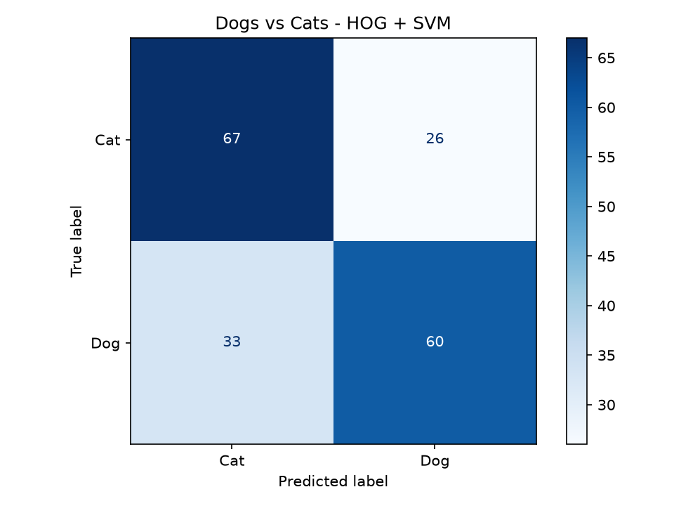

# Dogs vs Cats Image Classification using SVM

## Overview

This project uses a Support Vector Machine (SVM) to classify images as cats or dogs.

HOG (Histogram of Oriented Gradients) extracts image features based on edges and shapes. These features are used to train the SVM model.

## Dataset

The dataset contains 926 images:

- Cat images: 463
- Dog images: 463

Images are stored in separate folders:

- `dataset/cats/`
- `dataset/dogs/`

Each image is resized to 64 × 64 pixels before feature extraction.

## Technologies Used

- Python
- NumPy
- Pillow
- Scikit-image
- Scikit-learn
- Matplotlib
- Joblib

## Algorithm

1. Load cat and dog images.
2. Resize images to 64 × 64 pixels.
3. Extract HOG features.
4. Split the data into training and testing sets.
5. Train an SVM classifier.
6. Evaluate the model using accuracy and a confusion matrix.
7. Save the trained model.

## Model Performance

- Algorithm: Support Vector Machine (SVM)
- Feature extraction: HOG
- Kernel: Linear
- Test accuracy: 68.28%

The accuracy is based on the current train-test split and may vary with different datasets or splits.

## Results

### Confusion Matrix



## Project Structure

```text
SCT_ML_3/
├── dataset/
│   ├── cats/
│   └── dogs/
├── model/
├── results/
│   └── confusion_matrix.png
├── src/
│   ├── svm_model.py
│   ├── svm_model_backup.py
│   └── predict.py
├── .gitignore
├── README.md
└── requirements.txt
```

## Installation

Install the required libraries:

```bash
pip install -r requirements.txt
```

## Train the Model

Run this command from the project root:

```bash
python src/svm_model.py
```

The trained model is saved to:

`model/svm_dog_cat_model.pkl`

The confusion matrix is saved to:

`results/confusion_matrix.png`

## Predict a New Image

Run:

```bash
python src/predict.py
```

Enter the path to an image when prompted.

Example:

`dataset/cats/cat.9582.jpg`

The program predicts whether the image contains a cat or a dog.

## Internship Task

This project was developed as part of the Machine Learning Internship at SkillCraft Technology.

Task 03: Dogs vs Cats Image Classification using SVM.
